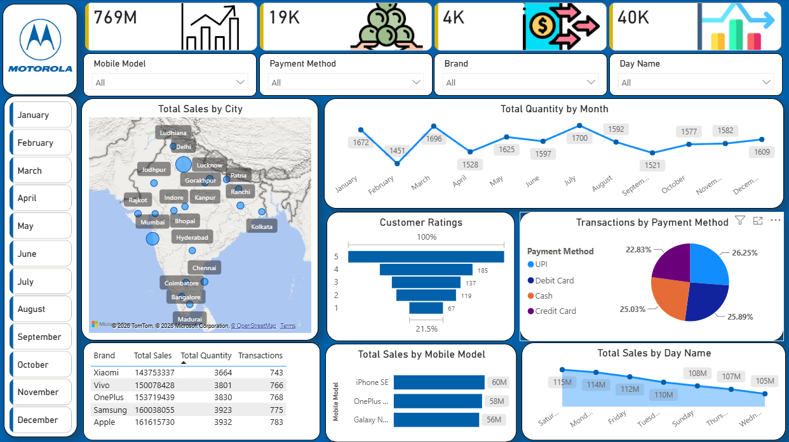

# Mobile Sales Analytics Dashboard
## Overview
An interactive Power BI dashboard developed to analyze mobile sales performance, customer ratings, payment methods, and sales trends across cities, months, brands, and mobile models.
## Dashboard Preview

## Key Features
- Total sales and transaction KPIs
- City-wise sales visualization using a map
- Monthly quantity trends
- Customer ratings analysis
- Payment method distribution
- Sales comparison by mobile model
- Sales analysis by day of the week
- Interactive filters for mobile model, payment method, brand, and day name
- Month-based filtering
## Tools & Technologies
- Microsoft Power BI
- Microsoft Excel
- Data Visualization
- Interactive Dashboard Design
- Sales Performance Analysis
## Dataset
`Mobile_Sales_Data.xlsx` contains transaction records, including:
- Transaction ID
- Date-related fields
- Brand and mobile model
- Units sold and price per unit
- Customer details
- City and payment method
- Customer ratings
## Project Files
- `Mobile_Sales_Dashboard_Project.pbix` — Power BI dashboard project.
- `Mobile_Sales_Data.xlsx` — Source dataset.
- `images/Mobile-Sales-Dashboard.png` — Dashboard preview.
## How to Use
1. Download the Power BI project and Excel dataset.
2. Open the `.pbix` file using Power BI Desktop.
3. If prompted, update the source data path to the downloaded Excel file.
4. Refresh the data if necessary.
5. Use the dashboard filters and visuals to explore mobile sales performance.
## Objective
To transform mobile sales data into actionable insights through interactive visualizations, KPI monitoring, and performance analysis.
